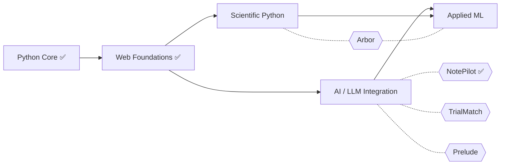

# Calvin Patel — Engineering Roadmap

I build AI and scientific software for health and neuroscience. I've written Python and MATLAB for neuroscience research since 2020, mostly analysis pipelines for neural recordings. In 2026 I started a structured effort to take that from research scripting to production engineering: Python from first principles, then the web stack, AI systems, and applied ML. This roadmap documents that work and the projects it ships.

**Legend:** ✅ complete · 🔄 in progress · ⬜ planned

---

## Background

**Education:** B.S. Neuroscience, UCLA · M.H.S., University of Maryland School of Medicine

| Research | Years | Work |
|---|---|---|
| Yang Lab, UCLA | 2021–2022 | 3D dendritic reconstruction of striatal medium spiny and cortical pyramidal neurons (neuTube, SWC) for large-scale morphology studies in Huntington's and Parkinson's disease mouse models |
| Mehta Lab, UCLA | 2020–2022 | Tetrode fabrication for chronic multi-region recordings; analysis of single-unit data across hippocampus and neocortex |
| Cedars-Sinai | 2021 | MATLAB/Python burst-detection and spike-annotation pipeline for in-vivo single-neuron recordings |
| Kornblum Lab, UCLA | 2020–2022 | Cryosectioning, immunofluorescent staining, and neural stem cell culture |

---

## Projects

| Project | What it is | Status |
|---|---|---|
| **[NotePilot](https://github.com/calvinpatel/notepilot)** | Clinical SOAP-note summarizer built as a staged LLM pipeline, with an evaluation harness (synthetic adversarial cases such as a planted penicillin contraindication, severity-triaged failures) and a results dashboard. <!-- add live demo URL at launch --> | ✅ Complete |
| **Arbor** | Neuron morphology toolkit: parses SWC reconstructions, computes tree-based morphometrics (length, branching, Sholl analysis) validated against NeuroMorpho.Org reference measurements, and serves an interactive 3D viewer. | ⬜ Next |
| **TrialMatch** | Clinical-trial matching agent: a bounded retrieval loop feeds a fixed evaluation stage that scores each eligibility criterion as met, failed, or unknown, then ranks trials by actionability. | ⬜ Planned |
| **Prelude** | Pre-visit clinical intake: a free-text complaint drives a tailored questionnaire and produces a structured history summary for the clinician. Safety-critical logic is deterministic; the LLM is limited to constrained classification and grounded summarization. | ⬜ Planned |

---

## Progress at a glance



---

## Phase 1 — Python Core

Goal: take Python from research scripting to production-grade code.

- ✅ **CS50 Foundations** (Feb–Mar 2026) — C, JavaScript, computer science fundamentals
- ✅ **Core Language Review** — types, control flow, data structures, functions and scope, comprehensions
- ✅ **Object-Oriented Programming** (Apr 2026) — classes, `__init__` and `self`, instance vs. class attributes, inheritance, `super()`, polymorphism, MRO, dunder methods, OOP patterns in Flask, LangChain, and PyTorch
- ✅ **Error Handling** (Apr 2026) — `try`/`except`/`else`/`finally`, the exception hierarchy, custom exceptions, LBYL vs. EAFP, defensive programming
- ✅ **File I/O & Persistence** (Apr 2026) — file modes and their contracts, `with` as sugar over `__enter__`/`__exit__`, `pathlib` (`/` as `__truediv__`), UTF-8 encoding, defensive per-row parsing, `csv` and `json`, streaming large files
- ✅ **Modules, Packages & Environments** (May 2026) — import mechanics, `__name__ == "__main__"`, packages and `__init__.py`, `pip`, `venv`/`uv`, dependency files
- ✅ **Decorators & Higher-Order Functions** (May 2026) — first-class functions, closures, writing decorators, `functools.wraps`, `@property`, logging, timing, and auth patterns
- ✅ **APIs & HTTP** (Jun 2026) — `requests`, HTTP methods, status codes, headers, auth, JSON payloads, rate limits, network error handling
- ✅ **Iterators & Generators** (Jun 2026) — the iterator protocol, `yield`, generator expressions, lazy evaluation, `itertools`
- ✅ **Type Hints & Static Analysis** (Jun 2026) — annotations, `typing`, generics, `mypy`
- ✅ **Testing** (Jun 2026) — `pytest`, fixtures, mocking (patch where the name is looked up), TDD, and the idea that shaped NotePilot: an LLM eval is a test with fuzzy assertions
- ✅ **Async Python** (Jul 2026) — `async`/`await`, the event loop, `asyncio`, concurrency vs. parallelism

## Phase 2 — Web Foundations

Goal: build and ship full-stack applications.

- ✅ **HTTP & Web Fundamentals** (Jun 2026) — client-server model, request/response cycle, REST, statelessness, cookies and sessions, CORS, HTTPS
- ✅ **SQL & Databases** (Jun 2026) — relational model, CRUD, JOINs, indexes, schema design, normalization, transactions and ACID, parameterized queries, PostgreSQL
- ✅ **SQLAlchemy & ORMs** (Jul 2026) — models, relationships, queries, Alembic migrations, when to drop to raw SQL
- ✅ **FastAPI** (Jul 2026) — route handlers, Pydantic models, dependency injection, background tasks, async endpoints, OpenAPI docs. Security ran through the arc: OAuth2/JWT, secrets hygiene, handling health data, lightweight threat modeling
- ✅ **HTML & CSS** (Jul 2026) — semantic HTML, Flexbox, Grid, responsive design
- ✅ **JavaScript for Python Developers** (Aug 2026) — syntax differences, async JS, `fetch`, DOM manipulation
- ✅ **React** (Aug 2026) — components, props, state, hooks, lists and keys, forms, calling a FastAPI backend
- ✅ **Shipping & Infrastructure** (Aug 2026) — Docker and Compose, GitHub Actions CI, deployment platforms, secrets management, structured logging; environment isolation and audit logging as compliance foundations
- ✅ **Git for Teams** (Aug 2026) — branching strategies, pull requests and code review, rebase vs. merge, conventional commits
- ✅ **Full-Stack Architecture** (Sep 2026) — React ↔ FastAPI integration, API design patterns, end-to-end auth

## Scientific Python

Goal: production fluency in the numerical stack behind scientific software and embeddings. Applied directly in Arbor.

- ⬜ **NumPy** — arrays, vectorization, broadcasting
- ⬜ **SciPy** — statistics, spatial data structures
- ⬜ **Visualization** — matplotlib, interactive 3D plotting

## Phase 3 — AI / LLM Integration

Goal: build AI-powered products by integrating, orchestrating, and evaluating existing models.

- ✅ **Prompt Engineering + LLM APIs** (Sep 2026) — system prompts, few-shot, chain-of-thought, templates; streaming, tool use, structured outputs, multi-turn conversations, token and cost management
- ✅ **Evals & LLM Testing** (Sep 2026) — eval design, adversarial test corpora, LLM-as-judge and its failure modes, severity triage, regression evals
- ⬜ **Embeddings & Vector Databases** — embeddings, semantic search, pgvector and Chroma, RAG vs. fine-tuning vs. long context
- ⬜ **Retrieval-Augmented Generation** — ingestion, chunking, hybrid search, reranking, citations, retrieval evaluation
- ⬜ **Agents + MCP** — tool-using agents, planning, ReAct, multi-agent systems, agent evaluation, building MCP servers; a survey of LangChain and LangGraph
- ⬜ **Production AI Engineering** — observability, prompt versioning, A/B testing, cost and latency monitoring, guardrails, fallbacks

## Phase 4 — Applied ML

Goal: move from integrating models to training and adapting them. A shared foundation, then two tracks.

```
            PyTorch fundamentals
             /                \
  4A Imaging & Scientific    4B Clinical NLP
  ML                         & fine-tuning
```

- ⬜ **PyTorch Fundamentals** — tensors, autograd, training loops, datasets and data loaders, MLOps basics
- ⬜ **4A: Imaging & Scientific ML** — image processing and segmentation, large volumetric datasets (chunked cloud formats, BossDB via `intern`, CloudVolume), Arbor v2 on EM-derived MICrONS neuron skeletons, a learned neuron-tracing model
- ⬜ **4B: Clinical NLP** — clinical text processing (negation, entity extraction, de-identification), parameter-efficient fine-tuning, and when fine-tuning beats prompting

---

## Working Principles

1. **Predict, then run.** Poke at it in the REPL before reaching for the docs.
2. **Errors are information.** Tracebacks are feedback; catch only what you can recover from.
3. **Enough depth to build.** Go deeper when a real problem demands it, not preemptively.
4. **Every topic feeds a build.** New skills go into a shipped project, not a notes file.

## Tools & Resources

- **Environment:** PyCharm Professional · uv · PostgreSQL · Git and GitHub
- **AI tools:** Claude for review and pair programming · Claude Code for agentic development
- **Courses and supplements:** [`SUPPLEMENTS.md`](./SUPPLEMENTS.md)
- **Site:** [calvinpatel.dev](https://calvinpatel.dev)

---

*Last updated: November 2026*
